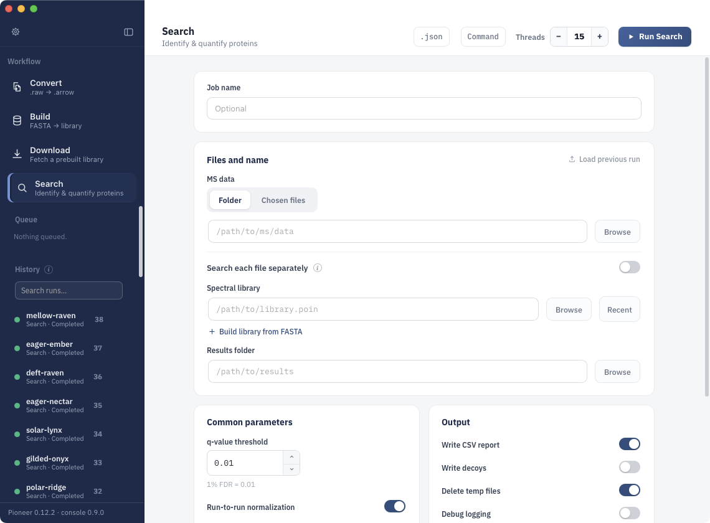

```@meta
CurrentModule = Pioneer
```

# Pioneer

Pioneer identifies and quantifies peptides and proteins from data-independent acquisition (DIA) experiments. It runs through both a graphical and a command-line interface and scales to thousands of runs on standard desktop hardware. Pioneer searches DIA experiments from Thermo Fisher, SCIEX, and Bruker instruments against spectral libraries of predicted fragment ion intensities and retention times. It builds *in silico* libraries using the [Koina](https://koina.wilhelmlab.org/) interface, and prebuilt libraries for several proteomes are downloadable through Pioneer.

## Key Features

- **Cross-Platform:** Runs on Linux, macOS, and Windows
- **Multi-Vendor:** Supports Thermo Fisher, SCIEX, and Bruker instruments. See [Tested Instruments](@ref) for the instruments and mass analyzers tested with Pioneer.
- **GUI:** Includes a graphical user interface
- **Fast:** Searches runs against whole-proteome *in silico* libraries 5–30× faster than the data are acquired
- **Scalable:** Processes experiments with hundreds to thousands of runs on standard desktop hardware (32–64 GB of RAM)
- **Deep Proteome Coverage:** Delivers high sensitivity, quantitative precision, and accuracy on diverse benchmark datasets
- **Regression Testing and FDR Control:** Maintains a public suite of regression tests across diverse instruments and acquisition schemes. Each tagged release triggers searches on the benchmark datasets, which include entrapment false discovery rate and false transfer rate analyses. [Browse the benchmarks](https://pioneeromics.bio/reports/).

## Graphical User Interface



## Get Started

- [Installation Guide](@ref): download and install Pioneer.
- [Quick Start Tutorial](@ref): a first search, step by step.
- [Parameter Configuration](@ref): what each setting does.
- [Function Reference](@ref): running Pioneer from the Julia REPL.

## Citation

Please cite the following when using Pioneer or Altimeter in published research:

> Wamsley, N. T., Wilkerson, E. M., Major, M., & Goldfarb, D. "Pioneer and Altimeter: Fast Analysis of DIA Proteomics Data Optimized for Narrow Isolation Windows." *bioRxiv* (2026). [doi:10.64898/2026.02.16.706201](https://doi.org/10.64898/2026.02.16.706201)

## License

©2026 Washington University

Washington University hereby grants to you a non-transferable, non-exclusive, royalty-free, non-commercial, non-clinical, not-for-use with human subjects, research license to use and copy the computer code that may be downloaded within this site (the “Software”). You agree to include this license and the above copyright notice in all copies of the Software. The Software may not be distributed, shared, or transferred to any third party. This license does not grant any rights or licenses to any other patents, copyrights, or other forms of intellectual property owned or controlled by Washington University.

If seeking a commercial license, please contact Washington University’s Office of Technology Management to request a license agreement: otm@wustl.edu.

YOU AGREE THAT THE SOFTWARE PROVIDED HEREUNDER IS EXPERIMENTAL AND IS PROVIDED “AS IS”, WITHOUT ANY WARRANTY OF ANY KIND, EXPRESSED OR IMPLIED, INCLUDING WITHOUT LIMITATION WARRANTIES OF MERCHANTABILITY OR FITNESS FOR ANY PARTICULAR PURPOSE, OR NON-INFRINGEMENT OF ANY THIRD-PARTY PATENT, COPYRIGHT, OR ANY OTHER THIRD-PARTY RIGHT. IN NO EVENT SHALL THE CREATORS OF THE SOFTWARE OR WASHINGTON UNIVERSITY BE LIABLE FOR ANY DIRECT, INDIRECT, SPECIAL, OR CONSEQUENTIAL DAMAGES ARISING OUT OF OR IN ANY WAY CONNECTED WITH THE SOFTWARE, THE USE OF THE SOFTWARE, OR THIS AGREEMENT, WHETHER IN BREACH OF CONTRACT, TORT OR OTHERWISE, EVEN IF SUCH PARTY IS ADVISED OF THE POSSIBILITY OF SUCH DAMAGES.

## Help and Contact

Report problems on the [Issues page](https://github.com/nwamsley1/Pioneer.jl/issues) and ask questions or suggest features on the [Discussions page](https://github.com/nwamsley1/Pioneer.jl/discussions).

Pioneer is developed in the [Goldfarb Lab](https://goldfarblab.wustl.edu/) and [Major Lab](https://majorlab.wustl.edu/) at Washington University in St. Louis by:

- Nathan Wamsley (n.t.wamsley@wustl.edu)
- Dennis Goldfarb (d.goldfarb@wustl.edu)
