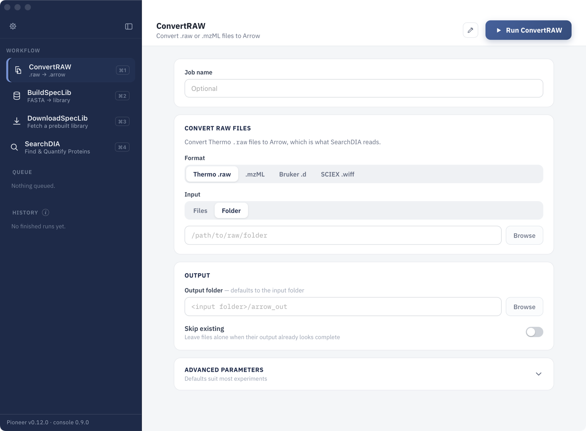
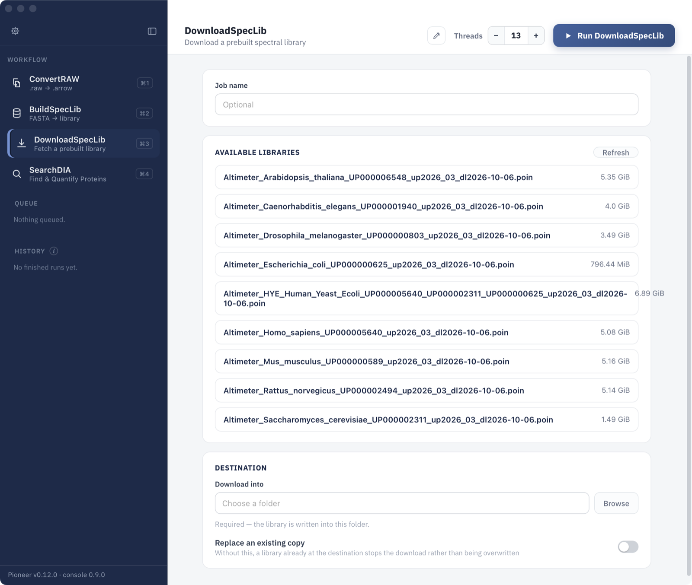
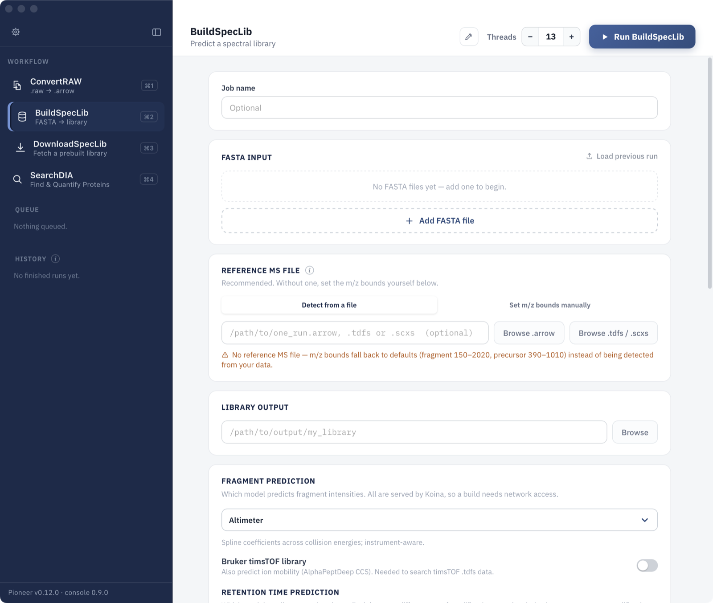
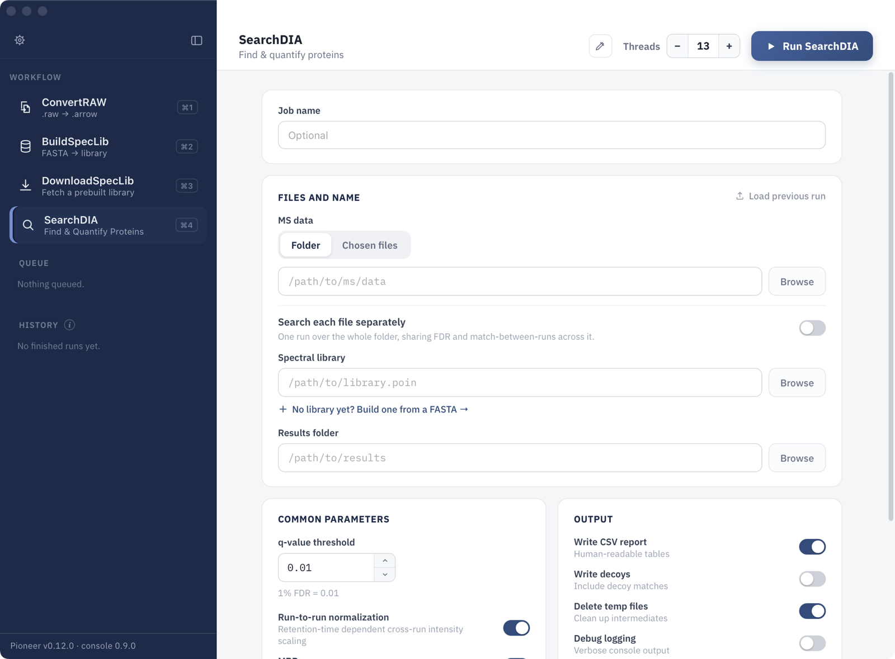

# Quick Start Tutorial

A Pioneer analysis has three steps: convert the raw files, get a spectral library, and search. Each step is a screen in the Pioneer app.

Open the app from Applications (macOS), the Start Menu (Windows), or the applications menu (Linux). The sidebar lists the screens:

* **ConvertRAW:** convert vendor raw files (Thermo `.raw`, Bruker `.d`, SCIEX `.wiff`) or `.mzML` files into the format Pioneer searches.
* **BuildSpecLib:** predict a spectral library from FASTA files.
* **DownloadSpecLib:** download a prebuilt spectral library.
* **SearchDIA:** identify and quantify peptides and proteins.

Started jobs appear under **Queue** while they run and under **History** when they finish. The version of Pioneer the app is using is shown at the bottom of the sidebar.

## 1. Convert Raw Files

Pioneer searches converted files rather than the vendor formats. Open **ConvertRAW**:



1. Under **Format**, choose the data type: Thermo `.raw`, `.mzML`, Bruker `.d`, or SCIEX `.wiff`.
2. Under **Input**, choose a folder of raw files, or individual files.
3. Optionally choose an **Output folder**. By default the converted files go into an `arrow_out` folder inside the input folder.
4. Click **Run ConvertRAW**.

Thermo and mzML files become `.arrow` files, Bruker runs become `.tdfs` files, and SCIEX runs become `.scxs` files. Turn on **Skip existing** to resume a conversion without redoing finished files.

## 2. Get a Spectral Library

A spectral library holds the predicted fragment spectra and retention times of every peptide Pioneer searches for. Download a prebuilt library, or build one from FASTA files.

### Download a Prebuilt Library

Open **DownloadSpecLib**:



1. Pick a library from **Available libraries**. Prebuilt libraries cover several model organisms and a human, yeast, and *E. coli* mix.
2. Choose the folder to **Download into**.
3. Click **Run DownloadSpecLib**.

### Build a Library from FASTA Files

Open **BuildSpecLib**:



1. Click **Add FASTA file** for each protein database to include.
2. Under **Reference MS file**, choose one converted run from the experiment. Pioneer reads the m/z ranges from it; without one, default ranges are used.
3. Under **Library output**, choose where to write the library.
4. Keep **Altimeter** as the fragment prediction model; it is the recommended default. For Bruker timsTOF data, turn on **Bruker timsTOF library** so the library includes ion mobility.
5. Click **Run BuildSpecLib**.

Predictions are made by the [Koina](https://koina.wilhelmlab.org/) server, so building a library needs an internet connection.

## 3. Search

Open **SearchDIA**:



1. Under **MS data**, choose the folder of converted files (or individual files).
2. Under **Spectral library**, choose the `.poin` library from step 2.
3. Under **Results folder**, choose where to write the results.
4. Check the common parameters. The defaults suit most experiments, including the 1% FDR (q-value 0.01) threshold.
5. Click **Run SearchDIA**.

All files in the folder are searched together, sharing false discovery rate control and match-between-runs. Turn on **Search each file separately** to run each file as its own search instead.

## 4. Results

The results folder contains:

| File | Contents |
|---|---|
| `precursors_long.tsv` / `.arrow`, `precursors_wide.tsv` / `.arrow` | Identified precursors and their quantities, one row per precursor and run (long) or one row per precursor with a column per run (wide) |
| `protein_groups_long.tsv` / `.arrow`, `protein_groups_wide.tsv` / `.arrow` | The same for protein groups |
| `run_summary.tsv` | One row of quality-control metrics per run |
| `qc_plots/` | Quality-control plots: retention time alignment, mass errors, collision energy, and quadrupole transmission |
| `pioneer_search_report.txt`, `pioneer_search_log.log` | A summary of the search and its full log |
| `config.json` | The parameters used, including defaults |

[Search Results](@ref) describes every column of these tables, the long and wide layouts, and the difference between the `.tsv` and `.arrow` files.

## Command Line

Every step in the app is also a `pioneer` subcommand:

```bash
pioneer --help
```

| Subcommand | What it does |
|---|---|
| `convert-raw` | Convert Thermo `.raw` files |
| `convert-mzml` | Convert `.mzML` files |
| `convert-bruker` | Convert Bruker timsTOF `.d` folders |
| `convert-sciex` | Convert SCIEX `.wiff` runs |
| `download` | Download a prebuilt spectral library (`--list` shows what is available) |
| `params-predict`, `predict` | Write a library-building parameter file, then build the library |
| `params-search`, `search` | Write a search parameter file, then run the search |

Run `pioneer <subcommand> --help` for the options of each subcommand.

The same analysis from the command line:

```bash
pioneer convert-raw raw_dir --output-dir arrow_dir
pioneer download --list
pioneer download <library> --dest lib_dir
pioneer params-search lib_dir/<library> arrow_dir results_dir --params-path search_params.json
pioneer --threads=8 search search_params.json
```

`--threads` sets the number of threads. To build a library instead of downloading one, use `pioneer params-predict` and `pioneer predict`. [Parameter Configuration](@ref) describes the settings in the parameter files.

## Docker

Pioneer is also published as a Docker image. Mount the data folder (here the current folder, as `/work`) and run any subcommand:

```bash
docker pull dennisgoldfarb/pioneer:latest
docker run --rm -it -v $(pwd):/work -w /work dennisgoldfarb/pioneer:latest pioneer --help
```

Images are tagged by release (for example `dennisgoldfarb/pioneer:v0.12.0`).
